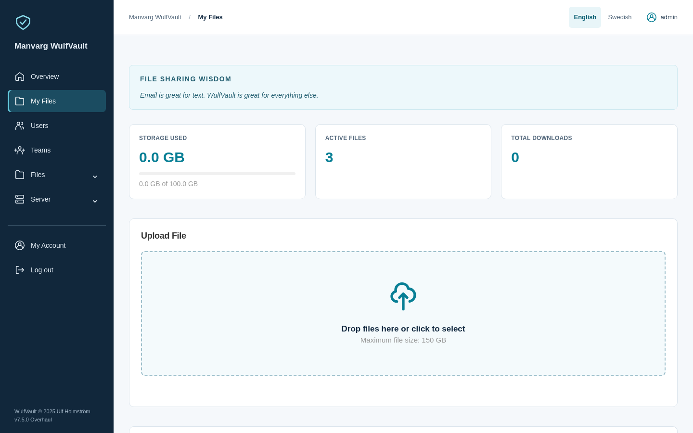
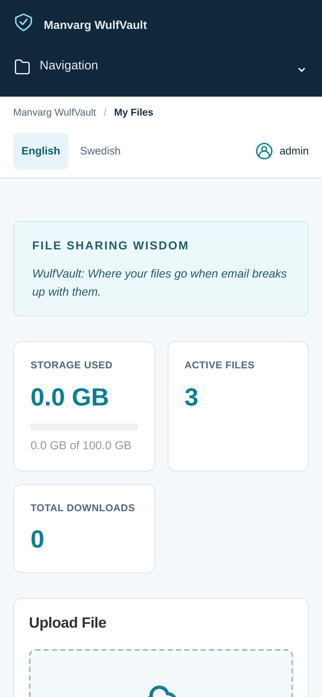
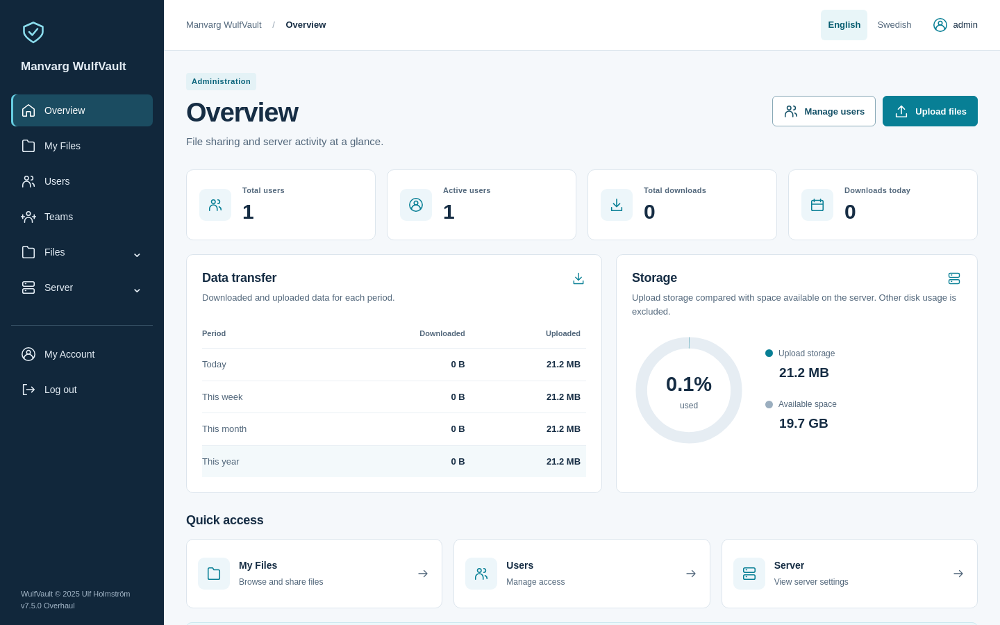
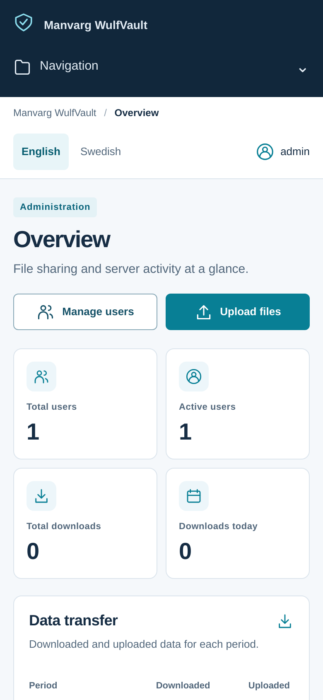
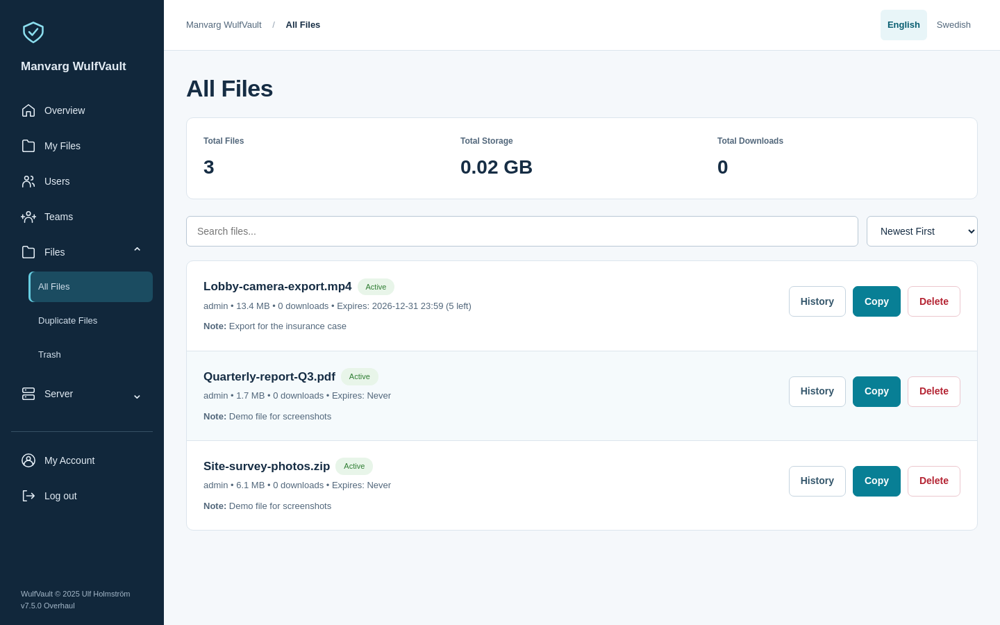
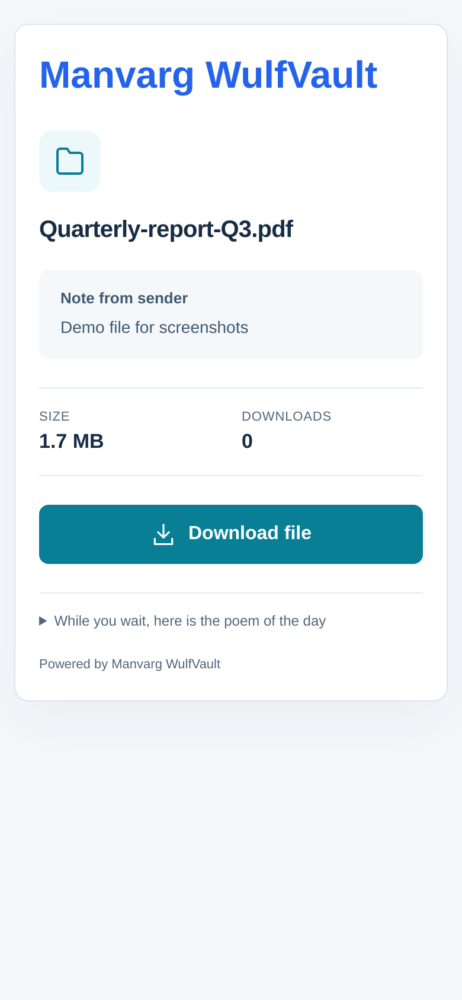

# WulfVault — Enterprise File Sharing Platform

**Version 7.5.1 Hardened Overhaul** · Self-Hosted · Open Source · AGPL-3.0

WulfVault is a self-hosted file sharing platform for organizations that need security, accountability, and full control over their data. Written in Go, it is a complete alternative to commercial file-transfer services — no subscriptions, no per-transfer fees, no practical file-size limit — with multi-user management, per-user quotas, enterprise audit logging, full download tracking, branded download pages, 2FA, SSO (Microsoft Entra ID + generic OpenID Connect), self-service password management, file-request portals, and GDPR-compliant account deletion.

> 🔒 **7.5.1 "Hardened Overhaul"** is a security rebuild of 7.5.0 (Go 1.27.3, all dependencies updated, pinned base images — `govulncheck`: 0 known vulnerabilities). Same interface as 7.5.0.

> ⚠️ **7.5 "Overhaul" is a complete redesign of the user interface.** Every page — sign-in, dashboard, files, uploads, file requests, teams, settings, the admin area and the public download pages — has been rebuilt on a new, modern app shell ("Wolf Overhaul"): one role-aware sidebar, a language switcher, unified cards, forms, tables and action buttons, full mobile layouts, and Swedish/English on the admin overview, dashboard, file and team views and the public download pages (the remaining admin pages are English for now). **No features, data formats, APIs or database schemas changed**, and upgrading is as safe as any other release. But if you and your users are happy with the classic 7.2 look, **do not upgrade** — there is no setting to bring the old interface back. Have a look at the [screenshots](#screenshots) first.

**Built for:** law enforcement, healthcare, legal, government, education, creative agencies — anyone sharing sensitive or very large files that need download tracking and compliance evidence.

> **New in 7.1 Aurora:** generic **OpenID Connect** alongside Microsoft Entra ID — Google Workspace, Okta, Keycloak, Authelia, Auth0 or any OIDC issuer. SSO is additive; local password accounts (including break-glass and service accounts) always remain. See [Single Sign-On](#single-sign-on).

---

## Screenshots

*7.5 Overhaul — the new interface on desktop and phone.*

| Desktop | Phone |
|---|---|
|  |  |
|  |  |
|  |  |

Also: [sign-in](docs/screenshots/desktop-login.png) · [teams](docs/screenshots/desktop-teams.png) · [account settings](docs/screenshots/desktop-settings.png) · [admin users](docs/screenshots/desktop-admin-users.png) · [the admin overview in Swedish](docs/screenshots/desktop-admin-sv.png) · [public download page, desktop](docs/screenshots/desktop-splash.png).


---

## Why WulfVault?

Organizations that share large files regularly hit the same walls: commercial services charge per user or transfer, big video exports exceed email limits, compliance requires knowing exactly who downloaded what and when, and sensitive data shouldn't leave your infrastructure.

WulfVault answers all four: your data stays on your own server, there are no per-transfer costs or user caps, every download is tracked with email and timestamp, and storage quotas are configurable per user. Large files (multi-gigabyte surveillance footage and the like) are supported with chunked, resumable uploads.

---

## Deploy

**One-click managed hosting** — deploy WulfVault with updates and backups handled for you, on the cloud provider and region of your choice:

[](https://elest.io/open-source/wulfvault)

**Self-host it yourself** — Docker, Docker Compose, or a single Go binary; see [Installation](#installation).

---

## Key Features

**File sharing & transfer**
- Drag-and-drop uploads; no practical size limit (chunked, resumable — tested with multi-GB video).
- Chunked upload engine: 25 MB chunks, exponential-backoff retry (up to ~7.5 min/chunk), full-screen progress with speed/ETA, and recovery through network drops, router restarts or overnight transfers.
- Two sharing modes: **direct links** (default) or **authenticated downloads** (recipient creates an email+password download account at upload time).
- Per-file password protection; expiring shares (after N downloads and/or Y days); flexible download-count limits (1–999).
- File comments/descriptions, searchable in admin; preview and metadata (size, date, download stats).
- Trash with configurable retention (1–365 days), one-click restore or permanent delete, and a full who/when audit trail.

**User management & access control**
- Roles: Super Admin, Admin, Regular user, and auto-created Download accounts (with a self-service portal for download history).
- Teams: shared file access, multi-team sharing, per-team quotas, Owner/Admin/Member roles, team badges and filtering.
- Per-user storage quotas (MB–TB), active/inactive status, bulk operations, real-time quota/usage dashboard.

**Download tracking & accountability**
- Complete audit trail: **who** (email on authenticated downloads), **when** (timestamps), **from where** (IP, with privacy controls).
- Per-file download history; CSV export for compliance; download-count expiry; optional download notifications.
- Modern admin dashboard: real-time users/downloads/storage metrics, growth trends, 2FA adoption, top files/users.

**Enterprise logging & monitoring**
- Comprehensive audit log of all user, auth, file-lifecycle, team and configuration actions, with configurable retention (1–3650 days).

**Single Sign-On**
- Microsoft Entra ID and generic OpenID Connect (Google, Okta, Keycloak, Authelia, Auth0, …). Additive to local accounts; configure under *Identity Providers*.

**Security & authentication**
- bcrypt password hashing (cost 12), TOTP 2FA with backup codes, self-service password reset.
- Secure 128-bit download hashes, session expiry (24 h, or 30 days with "Remember Me"), 10-minute inactivity logout (paused during transfers), CSRF protection, files stored outside the web root.

**Branding, email & file requests**
- Custom logo, colors and company name on the app and download pages.
- Send download links by email with customizable templates and notifications.
- Upload-request portals: shareable links that let others upload files **to** you.

**Administration**
- Web UI for users, teams, quotas, branding, settings, audit policy and audit-log export.

---

## Quick Start

1. **Start WulfVault** — see [Installation](#installation).
2. **First-run admin:** on first start (no users yet) WulfVault creates a super-admin from `ADMIN_EMAIL` / `ADMIN_PASSWORD`. If unset, the email is `admin@localhost` and a random password is **printed once to the server log** — copy it.
   ```bash
   ADMIN_EMAIL=admin@yourdomain.com ADMIN_PASSWORD='choose-a-strong-password' ./wulfvault
   ```
3. **Log in** at `http://your-server:8080/admin`, then change the password under Settings.
4. **Configure** the server URL, branding, users and per-user quotas.
5. **Share** — users log in at `http://your-server:8080`, drag files in, and send the share links.

> If you used the generated password, change it immediately after first login.

---

## Installation

Clone the repository once, then pick a method:

```bash
git clone https://github.com/Frimurare/WulfVault.git
cd WulfVault
```

**Docker**
```bash
docker build -t wulfvault/wulfvault:latest .
docker run -d --name wulfvault -p 8080:8080 \
  -v ./data:/data -v ./uploads:/uploads \
  -e SERVER_URL=https://files.yourdomain.com \
  wulfvault/wulfvault:latest
```

**Docker Compose** (uses the bundled `docker-compose.yml`)
```bash
docker compose up -d --build
```

**Build from source** (Go 1.21+)
```bash
go mod download
go build -o wulfvault cmd/server/main.go
./wulfvault
```

See [INSTALLATION.md](INSTALLATION.md) for Proxmox LXC, reverse-proxy and SSL guides.

---

## Configuration

| Variable | Description | Default |
|----------|-------------|---------|
| `SERVER_URL` | Public URL of the server | `http://localhost:8080` |
| `PORT` | Server port | `8080` |
| `DATA_DIR` | Database directory | `./data` |
| `UPLOADS_DIR` | Uploaded-files directory | `./uploads` |
| `MAX_FILE_SIZE_MB` | Maximum file size (MB) | `5000` (5 GB) |
| `DEFAULT_QUOTA_MB` | Default per-user quota (MB) | `5000` (5 GB) |
| `SESSION_TIMEOUT_HOURS` | Session expiration | `24` |
| `TRASH_RETENTION_DAYS` | Days to keep deleted files | `5` |
| `ADMIN_EMAIL` | First-run admin email | `admin@localhost` |
| `ADMIN_PASSWORD` | First-run admin password | random (printed to log) |

Branding, quotas, trash retention, file-size limits, session timeout and IP logging are also configurable in **Admin → Settings**. IP logging is off by default.

---

## API

WulfVault is primarily a server-rendered web app, but also exposes a JSON REST API under `/api/v1/*` for automation (default port `8080`):

```bash
# Verify session        → 200 {authenticated:true,…} / 401 {authenticated:false}
GET  /api/v1/auth/verify
GET  /api/v1/users          # list users (admin)
POST /api/v1/files          # upload a file
GET  /api/v1/stats          # system statistics (admin)
```

---

## Security

bcrypt password hashing (cost 12) · 128-bit random download links · session expiry with 10-minute inactivity logout · CSRF protection via SameSite cookies · files stored outside the web root · optional IP logging · no directory listing.

**Production setup:** change the admin password, terminate TLS at a reverse proxy (nginx/Caddy), expose only 80/443, back up `./data` and `./uploads`, watch the logs, and keep WulfVault updated.

---

## GDPR Compliance

WulfVault is **GDPR-ready (grade A-, 94%)**, built privacy-by-design and privacy-by-default: self-service data export (Art. 15/20) and account erasure with anonymizing soft-delete (Art. 17), rectification via settings (Art. 16), audit logging with configurable retention, TLS in transit, 2FA, data minimization (no analytics or tracking), and IP logging off by default. Only strictly-necessary session cookies are used, so **no cookie-consent banner is required** unless you add analytics.

A complete compliance pack — privacy/cookie/DPA templates, breach-notification procedure, ROPA, and a pre-launch checklist — lives in [`gdpr-compliance/`](gdpr-compliance/README.md). Note: encryption at rest is not built in; use OS-level disk encryption (LUKS/BitLocker/FileVault), which is also what HIPAA requires.

---

## Troubleshooting

- **Can't log in on first run** — the admin password was random and printed to the server log; check the startup output (or set `ADMIN_EMAIL`/`ADMIN_PASSWORD` before first launch).
- **Uploads fail** — check `MAX_FILE_SIZE_MB`, the user's quota, server disk space, and the browser console.
- **Download links don't work** — verify `SERVER_URL`, and that the file hasn't expired or been trashed.
- **More help** — [INSTALLATION.md](INSTALLATION.md), `docker compose logs -f wulfvault`, or open an [issue](https://github.com/Frimurare/WulfVault/issues).

The admin **Restart Server** button is disabled until a systemd service is installed; see [DEPLOYMENT.md](DEPLOYMENT.md) to enable it.

---

## Development

```bash
go test ./...                              # run tests
go build -o wulfvault cmd/server/main.go   # build
```

```
cmd/server/      entry point
internal/        auth · database · models · server
web/             static assets · templates
```

Contributions welcome — fork, branch, add tests, open a PR.

---

## License

**AGPL-3.0** (see [LICENSE](LICENSE) and [NOTICE.md](NOTICE.md)). The AGPL ensures that anyone offering WulfVault as a network service must share their modifications with the community, keeping the project open.

---

## Support

- Issues: https://github.com/Frimurare/WulfVault/issues
- Discussions: https://github.com/Frimurare/WulfVault/discussions
- Docs/Wiki: https://github.com/Frimurare/WulfVault/wiki
- Contact: ulf@manvarg.se

---

*Made for organizations that need secure, accountable sharing of large files.*
